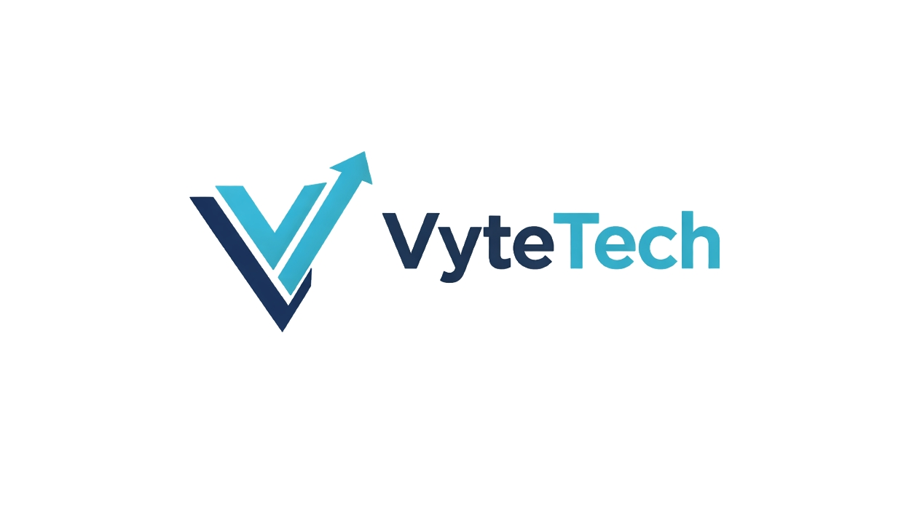

  

  # VyteTech

  **Software Engineering · AI & Automation · Digital Products**

  **Tecnologia sob medida para transformar operações e construir produtos digitais.**

  [Website](https://vytetech.com) · [Portfólio](docs/PORTFOLIO.md) · [LinkedIn](https://www.linkedin.com/company/vytetech/) · [Contato](mailto:contato@vytetech.com)

---

## Quem somos | About us

A **VyteTech** é uma software house brasileira especializada em **sites, sistemas web, APIs, integrações, automações e produtos digitais**. Combinamos engenharia de software, visão de negócio e experiência do usuário para criar soluções adequadas ao contexto de cada empresa.

**EN:** We are a Brazilian software engineering company building custom web applications, business systems, APIs, integrations and intelligent automation. Our focus is to turn business requirements into reliable digital products.

## O que construímos

| Especialidade | Como ajudamos |
| --- | --- |
| **Software sob medida** | Sistemas operacionais, plataformas web e ferramentas internas. |
| **Produtos SaaS** | Descoberta, arquitetura, MVP e evolução de produtos digitais. |
| **APIs e integrações** | Conectividade entre aplicações, serviços e processos. |
| **IA e automações** | Fluxos inteligentes, automação de tarefas e integrações orientadas a processos. |
| **Web e experiência digital** | Sites institucionais, experiências responsivas e interfaces administrativas. |
| **Arquitetura e evolução** | Qualidade, documentação, entrega contínua e manutenção. |

## Projetos selecionados

| Projeto | Solução | Acessar |
| --- | --- | --- |
| **Atelier Daniel Detomi** | Portfólio artístico, catálogo de obras e CMS multilíngue | [Ver projeto](https://github.com/vytetech/client-arte-e-natureza) |
| **Leitura da Borra de Café** | Experiência multilíngue, painel editorial e agendamentos | [Ver projeto](https://github.com/vytetech/client-leitura-da-borra-de-cafe) |
| **Vila Santa Rosa** | Plataforma de hospitalidade, reservas e administração | [Ver projeto](https://github.com/vytetech/client-vila-santa-rosa) |

**[Explorar portfólio técnico e estudos de caso →](docs/PORTFOLIO.md)**

## Tecnologia e engenharia

Nossas escolhas variam conforme os requisitos de cada projeto. Tecnologias presentes em projetos da empresa incluem:

- **Frontend:** React, TypeScript, Vite, Tailwind CSS, Next.js.
- **Backend e integração:** Node.js, Hono, tRPC, APIs REST.
- **Dados:** PostgreSQL, MySQL, Drizzle ORM e Supabase.
- **Infraestrutura:** Vercel, Render, Railway, GitHub Actions e pipelines de entrega.
- **Práticas:** documentação técnica, revisão de código, validações automatizadas e segurança por projeto.

Conheça nossos **[padrões de engenharia e colaboração](docs/ENGINEERING.md)**. A aplicação de cada prática depende do estágio e das necessidades do projeto.

## Nosso processo

**01. Descoberta** → **02. Arquitetura** → **03. Desenvolvimento** → **04. Validação e implantação** → **05. Evolução contínua**

Buscamos evitar complexidade desnecessária, tornar decisões técnicas rastreáveis e manter a solução sustentável após a entrega.

## Produtos próprios

Também desenvolvemos iniciativas internas e produtos digitais, como **TRILHA.X**, o **CRM VyteTech** e serviços da plataforma VyteTech. O código-fonte dessas iniciativas permanece privado quando aplicável.

## Vamos construir algo?

**[Conheça a VyteTech](https://vytetech.com)** · **[Envie sua demanda](mailto:contato@vytetech.com)** · **[Conecte-se no LinkedIn](https://www.linkedin.com/company/vytetech/)**

São Paulo, Brasil · Português / English

---

© 2026 VyteTech Solution LTDA. Repositórios podem conter software proprietário. A publicação de código não concede, por si só, permissão de uso, reprodução ou distribuição; consulte os termos e as licenças aplicáveis a cada projeto.
